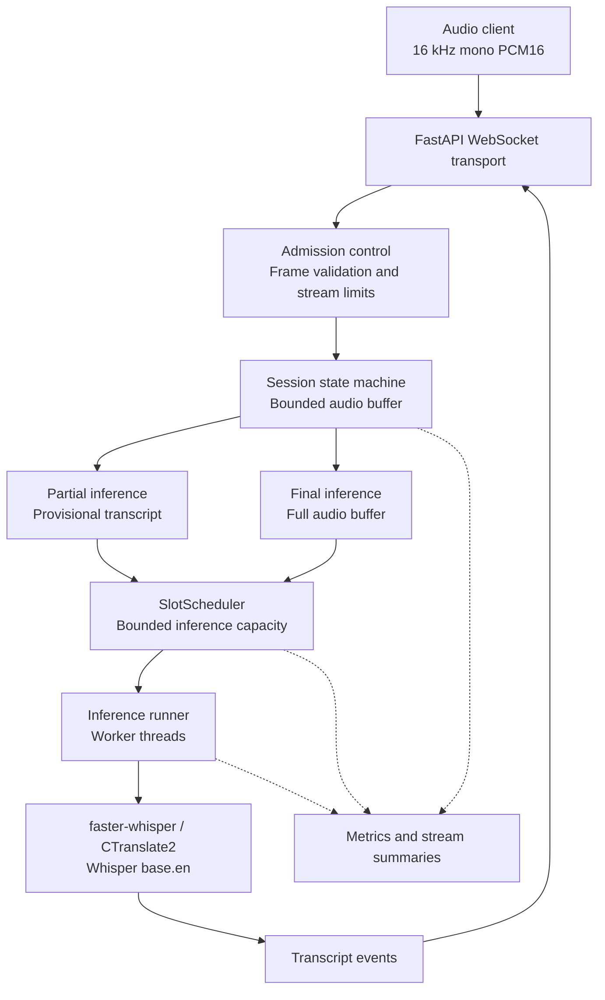
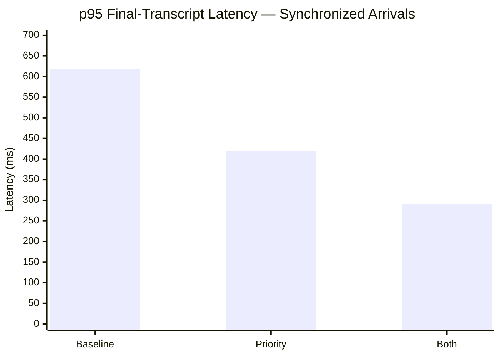
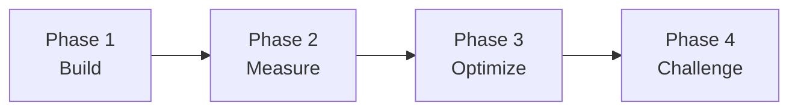

# EchoRelay

<div align="center">


### Engineering for the Tail

**A streaming speech-to-text server and empirical investigation into GPU inference scheduling and tail latency.**

Python · FastAPI · WebSockets · faster-whisper / CTranslate2 · Whisper `base.en` · NVIDIA T4

[Architecture](#architecture) · [Experimental Findings](#experimental-findings) · [Research Phases](#research-phases) · [Reproducibility](#reproducibility) · [Quick Start](#quick-start-local-cpu)

</div>

---

## Overview

EchoRelay is a Python-based streaming speech recognition service built to investigate a systems-engineering question:

> **Can we reduce high-percentile inference latency by changing how work is scheduled, without changing the underlying speech recognition model?**

The system accepts audio over WebSockets, generates provisional transcripts while audio arrives, and delivers one final transcript when a client explicitly ends the stream.

Beyond implementing a working inference API, EchoRelay examines how concurrent audio streams compete for limited GPU capacity, how scheduling decisions affect request latency, and whether observed performance improvements generalize across workload patterns.

The project combines **software engineering, production-oriented reliability mechanisms, GPU profiling, and reproducible experimentation**.

## Why Engineering for the Tail?

A service can have excellent average latency and still feel slow to users whose requests experience long delays.

**Tail latency** describes the slower portion of a request-latency distribution.

| Metric | Interpretation |
|---|---|
| **p50** | Half of requests finish within this latency |
| **p95** | 95% of requests finish within this latency; 5% take longer |
| **p99** | 99% of requests finish within this latency; 1% take longer |

For an interactive speech recognition service, the delay between finishing an utterance and receiving the final transcript directly affects perceived responsiveness.

EchoRelay measures **final-transcript latency** from the client's `end` message to receipt of its `final` event. This includes time spent waiting for inference capacity, decoding the audio, and delivering the result.

The distinction matters because faster model execution is not the only way to improve response time.

When several streams compete for a constrained inference worker, a request may spend more time waiting than executing.

**Engineering for the tail means identifying those delays, testing targeted changes, and understanding the conditions under which the changes succeed or fail.**

---
### Visualizing Tail Latency


*Conceptual illustration only. The latency values shown are not EchoRelay benchmark measurements.*
---

## Architecture

EchoRelay separates network transport, session management, inference scheduling, model execution, and observability.



### Streaming lifecycle

1. **Connect.** A client opens a WebSocket connection. The server enforces admission and stream limits.
2. **Receive audio.** The client sends binary frames containing 16 kHz mono PCM16 audio.
3. **Buffer.** A per-stream session maintains a bounded audio buffer and tracks its lifecycle.
4. **Produce partials.** At configured intervals, the system submits inference requests and sends provisional transcripts.
5. **End the stream.** The client sends an explicit `end` message.
6. **Produce the final.** EchoRelay decodes the complete audio buffer and delivers a final transcript after any preceding partial events.
7. **Clean up.** The session releases its resources and records an outcome summary.

### Why partial transcripts are provisional

Whisper is a window-based model, not a native streaming decoder.

EchoRelay approximates streaming recognition by periodically re-decoding buffered audio. This allows partial transcripts to be produced while a client speaks, but those hypotheses can change as additional audio arrives.

Partial events are therefore marked `"provisional": true`. Only the final event represents the committed transcript.

### Engineering decisions

| Component | Responsibility | Key consideration |
|---|---|---|
| **WebSocket transport** | Audio ingestion and transcript delivery | Admission limits, validation, disconnects, bounded sends |
| **Session state machine** | Audio buffering and transcript lifecycle | Ordering, one final per successful stream |
| **Audio buffer** | Retains PCM16 audio | Maximum duration and bounded memory |
| **Slot scheduler** | Grants inference execution capacity | FIFO by default; experimental priority and cancellation |
| **Inference runner** | Executes decoding outside the event loop | Worker threads, timeouts, slot conservation |
| **Model adapter** | Connects to faster-whisper | Configurable device and compute type |
| **Observability** | Records latency, queueing, and resource behavior | Distinguishing waiting time from execution time |

### Why scheduling matters

Simply increasing the number of inference workers does not guarantee lower latency when requests compete for constrained GPU resources.

EchoRelay uses `SlotScheduler` to bound concurrent inference execution. With the experimental flags disabled, it preserves FIFO scheduling behavior.

A slot is released only after the worker thread finishes, even if the caller times out or disconnects. This prevents an abandoned decode from causing inference capacity to be oversubscribed.

Experimental policies change which waiting jobs receive the next available slot, without changing the underlying speech recognition model.

See [Scheduling Design](docs/scheduling-design.md), [Protocol Specification](docs/protocol.md), and [Measurement Definitions](docs/measurements.md).

---

## Experimental Findings

### Research question

Can scheduling changes reduce final-transcript tail latency while preserving transcript correctness?

EchoRelay evaluates two mechanisms:

**Final-transcript priority**

Waiting final inference requests are served ahead of waiting partial requests. FIFO ordering is retained within each priority class.

**Obsolete-partial cancellation**

When a stream ends, a partial inference job that has not started executing can be cancelled, avoiding unnecessary work. A decode already running in a worker thread is not interrupted.

These mechanisms can be enabled independently and are **disabled by default**.

### Measured results

The following measurements were collected on an NVIDIA T4 GPU, using Whisper `base.en` with FP16 inference.

**p95 final-transcript latency — concurrency target of eight streams**

| Experiment | Baseline | Priority + cancellation | Change |
|---|---:|---:|---:|
| Phase 3 — synchronized arrivals | 562 ms | 266 ms | **−52.7%** |
| Phase 4 — synchronized arrivals | 618.9 ms | 291.4 ms | **−52.9%** |
| Phase 4 — staggered arrivals | 183.4 ms | 163.8 ms | **−10.7%** |

### Phase 4 synchronized-arrival comparison



*Phase 4, synchronized arrivals, NVIDIA T4, eight concurrent streams. Lower is better. The combined policy includes final priority and obsolete-partial cancellation.*

Under synchronized arrivals, the combined scheduling policy reduced measured p95 final-transcript latency by **52.9%** relative to baseline.

However, the result was workload-dependent.

### The generalization test

Phase 4 introduced staggered arrivals to investigate whether scheduling improvements would persist when streams were not started simultaneously.

Under this workload:

- Baseline p95 final latency was **183.4 ms**.
- The combined policy measured **163.8 ms**.
- The observed reduction was **10.7%**.
- The exploratory block-bootstrap interval for the difference included zero.
- The **preregistered improvement criteria were not demonstrated**.

This is an important outcome rather than an experiment to discard.

It suggests that synchronized bursts and the contention they create may be important to the size of the scheduling benefit.

The workloads also differed in observed average concurrency, so arrival timing cannot be isolated as the sole cause of the different results.

### Correctness and reliability

Across the Phase 4 experiment:

| Measure | Result |
|---|---|
| Streams completed | **960 / 960** |
| Final transcript identity | **100% across compared policies** |
| Word error rate | **5.31%** |
| Stress health checks | **155 / 156 passed** |
| GPU environment | **One NVIDIA T4 session** |

One recovery time-to-first-partial check exceeded its tolerance. Its cause was not established.

The results support the scheduling hypothesis under the tested synchronized workload, but do not establish a general production performance guarantee.

### Interpretation

**What the experiments support:** Scheduling policy can materially affect tail latency when final requests compete with queued partial inference work.

**What remains uncertain:** How large those benefits would be across different arrival distributions, hardware, models, inference-worker counts, and sustained production traffic.

**Why the flags remain off:** Final-priority scheduling has no aging or fairness guarantee. Under sustained final-request traffic, partial requests can starve or time out.

Read the [Phase 3 Scheduling Report](docs/benchmarks/scheduling-t4/README.md), [Phase 4 Preregistration](docs/experiments/phase4-staggered-arrival.md), and [Phase 4 Results](docs/benchmarks/phase4-t4/README.md).

---

## Research Phases

EchoRelay developed through a series of connected engineering investigations.



| Phase | Question | Engineering outcome |
|---|---|---|
| **1 — Foundation** | Can we build a bounded streaming inference service? | WebSocket server, audio buffering, model adapter, lifecycle handling, initial GPU evaluation |
| **2 — Measurement** | Where does latency originate under concurrency? | Queue/decode instrumentation, resource metrics, profiling, workload analysis |
| **3 — Scheduling** | Can inference scheduling reduce final latency? | Experimental priority and cancellation policies, correctness tests, synchronized GPU comparisons |
| **4 — Generalization** | Do the improvements persist with staggered arrivals? | Preregistered experiment, preserved GPU evidence, qualified findings |

### Engineering Evolution

The merged pull requests preserve the progression from implementation to experimental evaluation.

| Pull request | Focus |
|---|---|
| [PR #1](https://github.com/hydrangeas20/echorelay/pull/1) | Initial streaming service |
| [PR #2](https://github.com/hydrangeas20/echorelay/pull/2) | Measurement and observability |
| [PR #3](https://github.com/hydrangeas20/echorelay/pull/3) | Experimental inference scheduling |
| [PR #4](https://github.com/hydrangeas20/echorelay/pull/4) | Phase 4 experimental design and preregistration |
| [PR #5](https://github.com/hydrangeas20/echorelay/pull/5) | Phase 4 results, evidence, and analysis validation |

The engineering history illustrates a repeatable process:

**Understand → Build → Measure → Form a hypothesis → Change the system → Validate → Challenge the conclusion.**

---

## Reproducibility

EchoRelay includes committed benchmark results, analysis scripts, experiment documentation, server logs, and checksum manifests.

The goal is to make reported findings independently inspectable rather than relying solely on headline performance numbers.

### Evidence inventory

The final post-merge audit verified the following committed evidence:

| Collection | Verified files |
|---|---:|
| Phase 1 | 5 |
| Phase 3 | 60 |
| Phase 4 | 105 |
| **Total** | **170** |

All three expected manifests were present, and the referenced files matched their recorded checksums.

Verify the evidence with:

```bash
python -m benchmarks.verify_evidence
```

The verifier checks the manifests that exist. A complete repository audit should also independently confirm the expected manifest inventory.

### Test validation

The final post-merge audit ran the default test suite under:

- Python 3.11 and Python 3.13.
- All four combinations of the two experimental scheduling flags.
- Eight configurations in total.

**Result: 209 tests passed per configuration, with one real-model test deselected.**

The audit also confirmed baseline compatibility with scheduling flags disabled, including deterministic inference-order traces and WebSocket protocol probes.

### Reproducing the analyses

Phase 3 and Phase 4 analyses were independently regenerated in temporary directories and matched their committed outputs byte for byte under both tested Python versions.

Phase 1 Markdown analysis reproduced, while some JSON floating-point values differed in their final digit on Python 3.13.

The recorded GPU measurements are preserved; reproducing identical GPU performance on different hardware or in a different session is not guaranteed.

Detailed procedures and evidence are available in:

- [Phase 1 T4 Pilot](docs/benchmarks/phase1-t4/README.md)
- [Phase 3 Scheduling Results](docs/benchmarks/scheduling-t4/README.md)
- [Phase 4 Results and Evidence](docs/benchmarks/phase4-t4/README.md)
- [Colab GPU Workflow](benchmarks/COLAB.md)
- [Measurement Definitions](docs/measurements.md)

---

## Quick Start (Local, CPU)

Requires **Python 3.11 or newer**.

### Install

```bash
python3.11 -m venv .venv
source .venv/bin/activate
pip install -e ".[dev]"
```

### Run tests

```bash
pytest
```

The default suite uses fake or gated inference backends and does not require downloading Whisper model weights.

### Run with the real model

```bash
python -m echorelay --port 8000
```

The default backend uses Whisper `base.en`. The model weights are downloaded on first use if they are not already cached.

In another terminal:

```bash
curl localhost:8000/health

python clients/stream_wav.py path/to/speech.wav

# Send audio without real-time pacing
python clients/stream_wav.py path/to/speech.wav --speed 0
```

### Run without downloading a model

For protocol demonstrations and development, use the deterministic fake adapter:

```bash
ECHORELAY_BACKEND=fake python -m echorelay --port 8000
```

In another terminal:

```bash
python clients/stream_wav.py --synthetic 3
```

The fake adapter emits synthetic transcript tokens and is useful for exercising the WebSocket lifecycle without GPU access.

### Real-model smoke test

```bash
pytest -m whisper
```

This test requires access to the actual Whisper model weights and was not verified during the final post-merge audit because the model download was blocked.

### Docker

```bash
docker build -t echorelay .

docker run --rm -p 8000:8000 \
  -v echorelay-models:/models \
  echorelay
```

To preload the model during image construction:

```bash
docker build --build-arg PRELOAD_MODEL=1 -t echorelay .
```

---

## Project Layout

```text
src/echorelay/
  config.py           Environment settings and wire-format constants
  protocol.py         Message schemas, errors, and close codes
  audio.py            Bounded PCM16 audio buffering
  session.py          Per-stream lifecycle and transcript scheduling
  transport.py        WebSocket endpoint and admission control
  app.py              FastAPI application and model lifecycle
  metrics.py          Runtime metrics and distributions
  inference/
    base.py           Transcriber interface
    whisper.py        faster-whisper model adapter
    fake.py           Deterministic fake adapter
    runner.py         Thread-pool inference execution
    scheduler.py      Bounded slot scheduling and experimental policies

clients/
  stream_wav.py       Example streaming client

benchmarks/
  COLAB.md            GPU benchmark workflow
  load_test.py        Streaming workload generator
  stress.py           Concurrency and recovery scenarios
  compare_policies.py Scheduling-policy comparison
  analyze_arrival.py  Arrival-pattern analysis
  verify_evidence.py  Evidence manifest verification

docs/
  protocol.md         WebSocket protocol
  measurements.md     Measurement definitions
  scheduling-design.md
  experiments/        Experiment preregistration
  benchmarks/         Reports and committed evidence

tests/                Automated test suite
```

---

## Configuration

All environment variables use the `ECHORELAY_` prefix.

| Variable | Default | Purpose |
|---|---|---|
| `BACKEND` | `whisper` | `whisper` or `fake` |
| `MODEL_NAME` | `base.en` | faster-whisper model |
| `DEVICE` | `cpu` | `cpu`, `cuda`, or `auto` |
| `COMPUTE_TYPE` | `int8` | CTranslate2 compute type; GPU options include `float16` and `int8_float16` |
| `MODEL_DIR` | — | Model weights cache |
| `MAX_CONCURRENT_STREAMS` | `8` | Maximum admitted streams |
| `MAX_CONCURRENT_INFERENCE` | `1` | Maximum simultaneous inference decodes |
| `MAX_AUDIO_SECONDS` | `120` | Per-stream audio duration limit |
| `MAX_FRAME_BYTES` | `262144` | Maximum audio frame size |
| `IDLE_TIMEOUT_S` | `15` | Inactive stream timeout |
| `INFERENCE_TIMEOUT_S` | `30` | Queueing and decode timeout per job |
| `SEND_TIMEOUT_S` | `10` | Maximum duration of a client send operation |
| `EVENT_TIMING` | `false` | Include optional event timing data |
| `FINAL_PRIORITY` | `false` | Experimental final-priority scheduling |
| `CANCEL_QUEUED_PARTIAL_ON_END` | `false` | Experimental obsolete-partial cancellation |
| `PARTIAL_INTERVAL_S` | `1.0` | Audio interval between partial requests |
| `MIN_PARTIAL_AUDIO_S` | `0.5` | Minimum audio for first partial |
| `PARTIAL_BEAM_SIZE` | `1` | Partial decoding beam size |
| `FINAL_BEAM_SIZE` | `5` | Final decoding beam size |

### Experimental scheduling flags

Both flags remain **disabled by default**.

For a controlled local experiment, the combined policy can be enabled with:

```bash
ECHORELAY_FINAL_PRIORITY=true \
ECHORELAY_CANCEL_QUEUED_PARTIAL_ON_END=true \
python -m echorelay --port 8000
```

This is an experimental configuration, **not a recommended production deployment setting**.

---

## Design Notes

### Event-loop isolation

Model inference runs in dedicated worker threads rather than directly on the asyncio event loop.

`SlotScheduler` bounds inference execution capacity. Slots are released when worker threads actually finish, including after a caller timeout or disconnect.

### Bounded partial work

EchoRelay permits at most one partial inference operation in flight per stream.

Audio received while a partial decode is running remains buffered for a later partial. This limits queue growth at the expense of partial-update frequency under load.

### Complete-buffer decoding

Partials re-decode buffered audio. This is straightforward for short utterances but increases compute cost as the buffer grows.

The maximum audio duration limits this behavior.

### Transcript ordering

Partial transcripts are provisional.

For successful streams, the final transcript is sent after the stream's partial events, and the final decode uses the complete audio buffer.

### Explicit failures

The protocol reports errors using structured events and defined WebSocket close codes.

See [Protocol Specification](docs/protocol.md).

---

## Observability

EchoRelay exposes runtime measurements for investigating performance and reliability.

| Interface | Purpose |
|---|---|
| `GET /health` | Liveness, model information, and stream counts |
| `GET /metrics` | JSON metrics covering streams, inference, queueing, process resources, and distributions |
| `ECHORELAY_EVENT_TIMING=true` | Optional timing information in transcript events |
| `stream_summary` logs | Per-stream operational summaries without transcript text |

Available measurements include:

- Partial and final inference queue wait.
- Partial and final decode time.
- Inference real-time factor.
- Active and rejected streams.
- Buffered audio.
- Event-loop lag.
- Partial transcript staleness.
- Partial re-decode amplification.
- Process CPU, memory, and thread counts.
- Scheduler configuration and workload-level observations.

Metrics help distinguish **time spent computing** from **time spent waiting for capacity**.

See [Measurement Definitions](docs/measurements.md) for exact timing boundaries, statistical definitions, and exclusions.

---

## Known Limitations

EchoRelay is a research-oriented streaming inference service. It is **not presented as a production-hardened, multi-tenant speech recognition platform**.

### Inference and streaming

- Whisper is window-based; partial streaming is implemented through repeated decoding.
- Partial inference cost increases with buffered audio duration.
- The service does not implement voice activity detection or automatic endpointing.
- Clients must explicitly send `end`.
- Input is restricted to 16 kHz mono PCM16.
- Running worker-thread decodes cannot be forcibly interrupted.

### Reliability and security

- No built-in authentication, TLS termination, or per-client rate limiting.
- Single-process architecture with one model instance.
- Production deployment would require additional operational and security controls.
- A shutdown-related server error was observed with Starlette 1.8 during audit testing.

### Scheduling

- Final-priority scheduling has no aging or fairness mechanism.
- Under sustained final-request traffic, partial requests can starve or time out.
- The scheduling policies remain disabled by default.
- Further work is required before enabling final priority in production.

### Experimental validity

- GPU measurements were collected in a single NVIDIA T4 session.
- The evaluation corpus contains a small number of repeated utterances.
- Within-run observations are correlated.
- Phase 4 collected only two runs per experimental cell.
- Exploratory intervals may understate uncertainty.
- Synchronized and staggered workloads differed in observed average concurrency.
- One Phase 4 recovery health check failed its tolerance.
- Results have not been independently replicated across GPU types, model sizes, or production workloads.

These limitations are part of the engineering record and inform the next research questions.

---

## Benchmarks and Research Documentation

| Resource | Contents |
|---|---|
| [Phase 1 T4 Pilot](docs/benchmarks/phase1-t4/README.md) | Initial GPU evaluation, methodology, and results |
| [Phase 2 Plan](docs/phase2-plan.md) | Bottleneck hypotheses and measurement plan |
| [Phase 3 Scheduling Results](docs/benchmarks/scheduling-t4/README.md) | Scheduling experiments, analysis, and evidence |
| [Phase 4 Preregistration](docs/experiments/phase4-staggered-arrival.md) | Registered hypotheses and methodology |
| [Phase 4 Results](docs/benchmarks/phase4-t4/README.md) | Synchronized and staggered workload comparisons |
| [Scheduling Design](docs/scheduling-design.md) | Scheduler mechanics, invariants, and race conditions |
| [Measurement Definitions](docs/measurements.md) | Metrics, timing boundaries, and analysis methodology |
| [GPU Workflow](benchmarks/COLAB.md) | Colab experiment execution |
| [Protocol](docs/protocol.md) | WebSocket messages and error behavior |

---

## Future Work

The next engineering questions include:

1. **Fair scheduling:** Investigate aging or bounded priority to prevent partial-request starvation.
2. **Streaming efficiency:** Evaluate sliding-window decoding and committed-prefix approaches to reduce repeated computation.
3. **Workload generalization:** Test additional arrival distributions, audio durations, concurrency levels, and worker counts.
4. **Replication:** Repeat experiments across independent GPU sessions and hardware configurations.
5. **Production hardening:** Improve dependency reproducibility, authentication, rate limiting, shutdown behavior, and deployment controls.
6. **Experimental tooling:** Strengthen configuration-deviation checks, output-directory safety, and expected-manifest validation.

Each improvement should be evaluated against correctness, latency, throughput, resource usage, and operational complexity—not latency alone.

---

## Project Philosophy

EchoRelay began as a streaming speech recognition service and evolved into an investigation of how inference systems behave under contention.

Its central lesson is that **the slowest requests are not necessarily slow because the model is slow**. They may be delayed by the way a system allocates constrained resources.

Improving those requests requires understanding the full path from arrival to completion, not optimizing a single component in isolation.

**Build the system. Measure the bottleneck. Test the hypothesis. Preserve the evidence. Challenge the result.**

*Engineering for the Tail.*